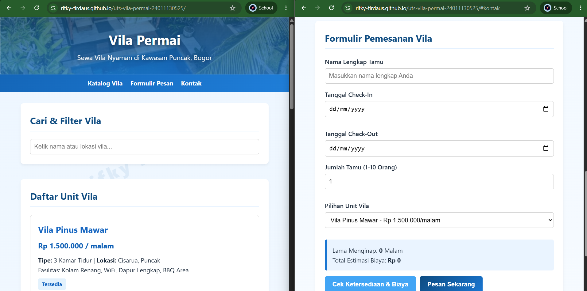
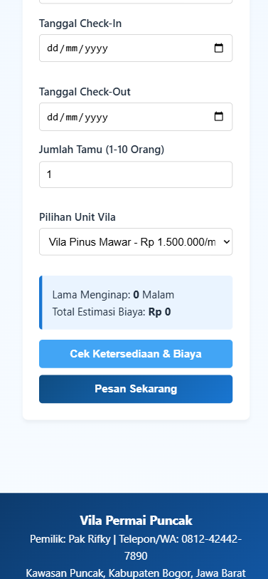
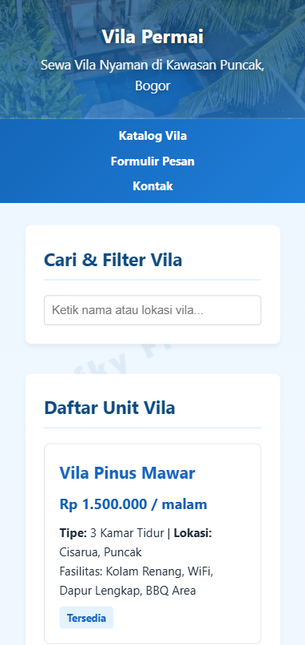
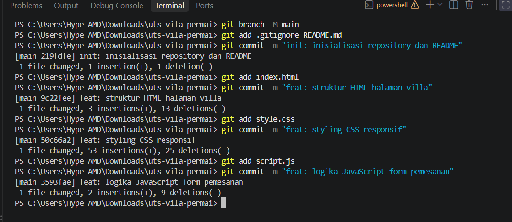

# UTS Teknologi Web - Aplikasi Pemesanan Vila Permai

## Identitas Mahasiswa
- Nama: Rifky Firdaus
- NIM: 24011130525
- Kelas: MI/5AM
- Nama Repository: uts-vila-permai-24011130525

## Deskripsi Aplikasi
Aplikasi web statis berbasis Client-Side untuk pemesanan kamar pada unit usaha Vila Permai di kawasan Puncak, Bogor. Didesain secara responsif dan tanpa bergantung pada basis data server (menggunakan Array Objek JavaScript & LocalStorage).

## Cara Menjalankan
1. Clone repository ini: `git clone https://github.com/rifky-firdaus/uts-vila-permai-24011130525`
2. Buka folder proyek.
3. Klik ganda file `index.html` untuk memuat halaman di browser (atau gunakan extension Live Server di VS Code).

## Status Fitur
- [x] Dokumen HTML5 Semantik Valid
- [x] Styling CSS Eksternal Responsif (2 Breakpoint: 768px & 480px)
- [x] Render Dinamis Data Vila via JS (`createElement` & `appendChild`)
- [x] Filter / Pencarian Vila berdasarkan Nama/Lokasi
- [x] Kalkulasi Total Biaya Otomatis
- [x] Validasi Input Berbahasa Indonesia
- [x] Fitur Penyimpanan Nama Tamu di LocalStorage

## Tangkapan Layar (Screenshot)

1. **Tampilan Utama Browser (Desktop View)**

   

2. **Tampilan Responsif Mobile View**

   

   

3. **Riwayat Commit GitHub**

   
